<!-- ══════════════════════════════════════════════════════ -->
<!-- HEADER                                                  -->
<!-- ══════════════════════════════════════════════════════ -->

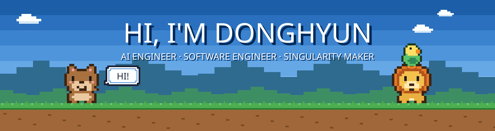

<!-- ══════════════════════════════════════════════════════ -->
<!-- INTRO                                                   -->
<!-- ══════════════════════════════════════════════════════ -->

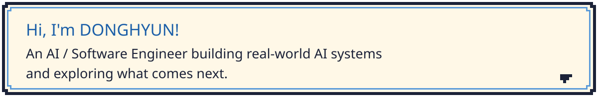

<!-- ══════════════════════════════════════════════════════ -->
<!-- NOW                                                     -->
<!-- ══════════════════════════════════════════════════════ -->

`Last updated Nov 2026`

- 🏢 **FDE & AX Advisor @ [Samsung Global Research](https://www.samsungsgr.com/)** (part-time via [Centrogics](https://centrogics.com/)) — Providing hands-on AI consulting and development support for researchers. Contributed to projects including a hospital logistics system, financial trend email automation, hypothesis-driven multi-agent systems, a presentation deck agent, and Japanese translation skills.

- 🎯 **AI Engineer @ [GROVA Technology (HK)](https://www.aiprofita.com/)** — Building **Profita**, an AdTech AI agent that turns an App Store link into competitor research, creative briefs, AI-generated image/video/playable ads, quality checks, and ad-platform exports.

- 🦾 **Undergraduate Researcher @ [Hanyang HCC Lab](https://hcc.hanyang.ac.kr/)** — First author of a **KDMS 2026 poster paper** on industrial image semantic labeling using SAM 3, RESAnything, and MLLM-based multimodal context mining. Developed an AI labeling agent and a Human-in-the-Loop label propagation workflow. Also developing a robotic automation system that translates CNC panel images and natural-language instructions into executable button-press sequences.

- 🏦 **Undergraduate Researcher @ Hanyang × [EY Han Young](https://www.ey.com/ko_kr)** — Developing an AI assistant agent that analyzes banking procedure manuals and generates **as-is process maps** using locally deployed open-source models to support consulting workflows.

- 🏛️ **Youth Public AX Supporter @ [Ministry of the Interior and Safety](https://www.mois.go.kr/)** — Developing **Youth Money Map (청년머니맵)**, an AI-powered service that matches young people with relevant financial support programs based on their circumstances.

- 🐦 **Founder @ [Perch](https://perch.ai.kr/ko)** — Redesigning the AI-powered bird care app with a stronger focus on data-driven health tracking, while developing an **ESP32-C3 smart perch scale** for automatic weight monitoring.

- ☁️ **Core Team @ [ASBG at HYU](https://asbg-hyu.vercel.app/)** — Founding member of Hanyang University's AWS Student Builders Group, organizing weekly cloud study sessions and hands-on AWS workshops.

<!-- ══════════════════════════════════════════════════════ -->
<!-- GYM CHALLENGE                                           -->
<!-- ══════════════════════════════════════════════════════ -->

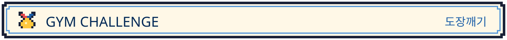

 

<i>Every gym I've walked into so far, numbered in the order I showed up.</i>

  <a href="https://apps.apple.com/us/app/%ED%8D%BC%EC%B9%98%EC%BC%80%EC%96%B4/id6758549078?l=ko">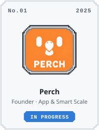</a>
  <a href="https://github.com/Happ11quokka/StockNewsEstimator">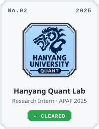</a>
  <a href="https://kr-newsroom.nexon.com/press-center/3399289">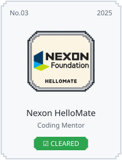</a>
  <a href="https://github.com/Happ11quokka/SWE-G04-SPACE">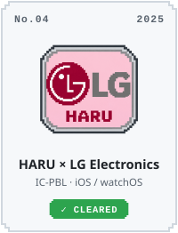</a>

  <a href="https://github.com/Happ11quokka/koplegame">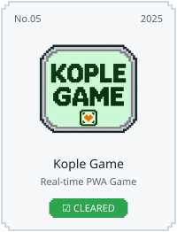</a>
  <a href="https://github.com/Happ11quokka/hyu-ngv-manufacturing-ai-agent">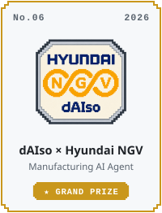</a>
  <a href="https://www.aiprofita.com">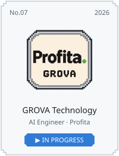</a>
  <a href="https://github.com/Happ11quokka/lg-aimers8-llm-compression">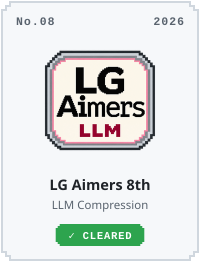</a>

  <a href="https://github.com/Happ11quokka/hackathon-store">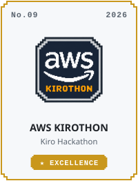</a>
  <a href="https://github.com/Happ11quokka/agentic-rag">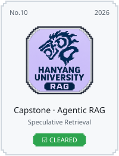</a>
  <a href="https://github.com/Happ11quokka/kakao_impact">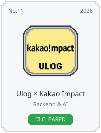</a>
  <a href="https://hcc.hanyang.ac.kr/">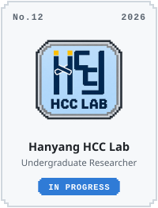</a>

  <a href="https://www.credly.com/badges/99ddc943-1d93-48bc-8511-415eb236ccd4">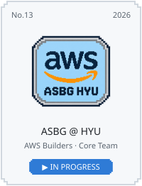</a>
  <a href="https://www.samsungsgr.com">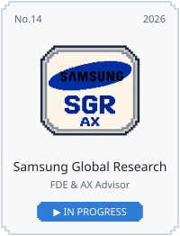</a>
  <a href="https://www.ey.com/ko_kr">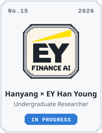</a>
  <a href="https://www.mois.go.kr">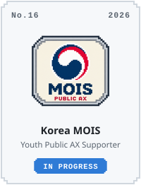</a>

<!-- ══════════════════════════════════════════════════════ -->
<!-- TECH STACK                                              -->
<!-- ══════════════════════════════════════════════════════ -->

 

<!-- ══════════════════════════════════════════════════════ -->
<!-- EXPERIENCE                                              -->
<!-- ══════════════════════════════════════════════════════ -->

 

### 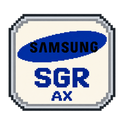 Samsung Global Research — FDE & AX Advisor 

`Part-time · Employed by Centrogics · On-site FDE` · `Sep 2026 – Present`

> Researchers at a corporate think tank want AI in the work they already do. I work on-site as a forward-deployed engineer: I find the problem with them, check what the tech can actually handle, and build the tool.

-  &nbsp;**AX consulting → build** — technical lead on a three-person AX Advisor team for SGR's research groups (research coordination, bio, logistics, management, finance, insurance, accounting). I check what's feasible and build it: a financial-markets mailing service, a Japanese translation Skill that also translates charts, and a fleet-sizing simulator and dashboard for hospital logistics
-  &nbsp;**Hands-on AI education** — sessions on agents, Skills, MCP and workflows with Claude Code, so non-developers can automate their own work. The signature session builds on **Matt Pocock**'s approach to AI coding agents
-  &nbsp;**Deck Agent (report → deck)** — drafts a deck in the official company format: the template becomes JSON slot schemas and HTML, Claude Code drives it through a local **MCP server**, two human checkpoints sit in a Canva-style studio, and decks export as HTML or PPTX

---

### 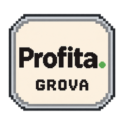 GROVA TECHNOLOGY (HK) LIMITED — AI Engineer Intern <picture><source media="(prefers-color-scheme: dark)" srcset="https://raw.githubusercontent.com/Happ11quokka/Happ11quokka/main/assets/profita-white.png"></picture>

`Intern · AdTech · Multi-agent development · Ad operations & analysis` · `Jan 2026 – Oct 2026`

> Profita is GROVA's AI ad-ops platform: paste one App Store link and it analyses the app and its competitors, plans the ads, produces and checks the creatives, and uploads them to ad platforms. I built the multi-agent system behind it, the chat Studio clients work in, and the operator Console.

-  &nbsp;**Agent harness** — a hand-written TypeScript harness keeps the LLM apart from execution: code fixes the node order, every model turn passes budget and tool checks, and untrusted competitor ads are read only by isolated model calls
-  &nbsp;**Profita Creative Engine** — intelligence → strategy → production → QC → export. Production agents generate Gemini images, Gemini keyframes animated by **Seedance 2.0** and cut in FFmpeg, Codex-built HTML **playables**, and ElevenLabs voice over Lyria music. QC failures are re-rendered or regenerated before a human steps in, and runs ship as AppLovin / Meta packages
-  &nbsp;**Studio & Console** — a React chat Studio with confirmation cards, Human-in-the-Loop approval gates and a React Flow **Agent Map**, plus an operator Console and queue worker. A per-request read cache with parallel prefetch cut the gallery from 86 SQL queries to 11, and replies stream over SSE
-  &nbsp;**Shanghai investor demo** — ran the live demo and Q&A for VCs and investors in Shanghai: the architecture, ad-platform integration (MCP, later in-process tools) and multi-agent runs traced through their logs

---

### 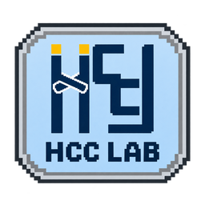 Hanyang University HCC Lab (한양대학교 HCC 연구실) — Undergraduate Researcher <picture><source media="(prefers-color-scheme: dark)" srcset="https://raw.githubusercontent.com/Happ11quokka/Happ11quokka/main/assets/hccl-white.png">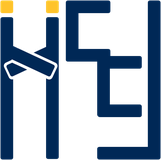</picture>

`Summer Research Intern · Dept. of Data Science · Human-Centered Computing Lab` · `Jul – Aug 2026 (summer internship)` · `Sep 2026 – Present (HY_UP research practicum)`

> Industrial images are full of objects that look identical but **mean** different things. I automate meaning-based labeling for these images and turn natural-language instructions into CNC panel operations for a robot arm, using multimodal AI and Human-in-the-Loop agent pipelines.

-  &nbsp;**Semantic labeling by multimodal context mining** — OCR + an MLLM turn panel text into meaning-based concept prompts for **SAM 3**. One SAM 2 click becomes an image exemplar that finds every look-alike, attribute prompting reads LED state, and labels propagate to the batch for Human-in-the-Loop review (LangGraph)
-  &nbsp;**Natural-language CNC robot control** — YOLOv8 reads the panel's keys and lamps, the instruction becomes a goal state, and ApBot's **goal-conditioned A\*** over a manual-grounded state machine returns the press order with 2D coordinates for the arm. Built for two real panels; rule vs. cloud vs. local LLM goal extraction compared for offline use
-  &nbsp;**KDMS 2026 poster, first author** — *Multimodal Context Mining for Semantic Labeling of Industrial Images*

---

### 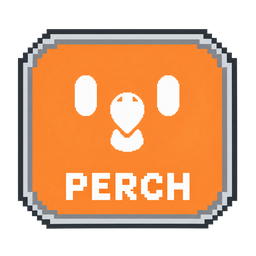 Perch — Founder 

`Founder` · `Mar 2025 – Present`

> Bird owners struggle to catch health problems early, and avian vets are hard to reach. I founded and run PerchCare, an AI health-management platform for pet birds.

- <picture><source media="(prefers-color-scheme: dark)" srcset="https://cdn.simpleicons.org/apple/white"></picture> &nbsp;**Launch & growth** — live on the iOS App Store with **680+ sign-ups** in KR · EN · 中文; backed by Hanyang University's Startup Support Center and selected as a Saehaeam Foundation startup scholar
-  &nbsp;**RAG & hybrid AI agent** — a knowledge base of 30+ species and 50+ diseases from a Shanghai exotic-animal hospital's clinical material, searched with **HyDE** + pgvector HNSW + re-ranking. Questions are routed by type and language (DeepSeek adds context for 中文), and GPT-4o Vision photo check-ups and the Dr. Aeng (앵박사) chatbot answer against the bird's own records
-  &nbsp;**IoT smart perch scale** — weighs the bird when it lands, so there's no handling stress: ESP32-C3 on a 44 × 44 mm KiCad board with Li-Po power and an I²C load cell

---

### 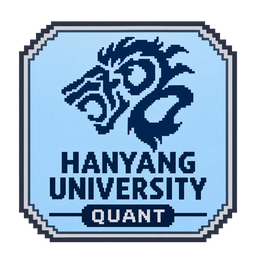 Hanyang Quant Analytics Lab (한양대학교 퀀트분석 연구실) — Undergraduate Research Intern <picture><source media="(prefers-color-scheme: dark)" srcset="https://raw.githubusercontent.com/Happ11quokka/Happ11quokka/main/assets/hanyang-business-white.png">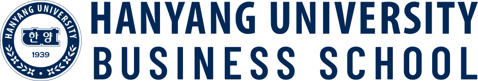</picture>

`Business School · Quantitative Analytics Lab` · `Mar – Jul 2025 (research intern)`

> Can an LLM's read of the news be used as a trading signal in Korean equities? I was second author on the paper that tested it.

-  &nbsp;**GPT news-sentiment strategy** — scored **~500K Maeil Business articles** (2022.01–2025.03) with GPT-4.1 Nano, mapped each article to its listed stock, and joined the result to FnGuide daily prices
-  &nbsp;**Market-neutral long-short backtest** — daily-rebalanced portfolio, long on positive-sentiment stocks and short on negative, with entry and exit set by publication window (PRE / IN / AFTER / DAY-OFF)
-  &nbsp;**APAF 2025 paper, 2nd author** — **+11.91%** cumulative return, Sharpe 0.38, against **KOSPI −14.43%** over the same period

<!-- ══════════════════════════════════════════════════════ -->
<!-- FEATURED WORK                                           -->
<!-- ══════════════════════════════════════════════════════ -->

 

### 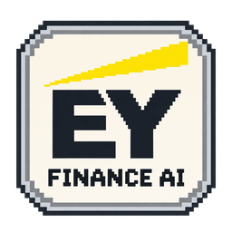 As-Is Process Agent <picture><source media="(prefers-color-scheme: dark)" srcset="https://raw.githubusercontent.com/Happ11quokka/Happ11quokka/main/assets/ey-logo-white.svg"></picture>

`Undergraduate researcher · Hanyang University × EY Han Young industry–academia PoC` · `Sep 2026 – Present`

> Consultants rebuild a bank's **as-is** process by hand from its manuals. On a four-person Hanyang × EY team, I build the agent that drafts it on local models.

-  &nbsp;**Manual → clauses** — local VLMs (Qwen3.5, Gemma 4, PaddleOCR-VL) read scanned manuals, which are split into clause chunks with stable IDs and cross-references linked across pages
-  &nbsp;**As-is process graph** — schema-constrained extraction of activities, roles, documents and branches, each cited to its clause, with HITL, pain-point and to-be candidates for consultants
-  &nbsp;**Closed-network ready** — a fixed-stage pipeline with constrained decoding through one OpenAI-compatible client: Ollama in development, vLLM inside the bank

---

### 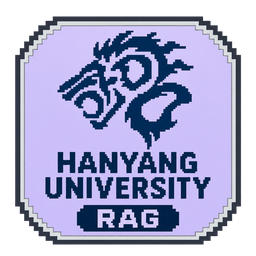 Hanyang University Capstone — Retrieval Latency Hiding in Agentic RAG <picture><source media="(prefers-color-scheme: dark)" srcset="https://raw.githubusercontent.com/Happ11quokka/Happ11quokka/main/assets/hanyang-white.png"></picture>

`Hanyang University CSE capstone · 2026` · `Advised by Prof. Hunjun Lee · two-student team (Donghyun Lim, Cheolwan Park)`

> *소형 LLM을 이용한 Agentic RAG 검색 Latency Hiding 가능성 탐구* — can a small draft LLM run the target's next search early and hide retrieval latency?

-  &nbsp;**Disk-scale retrieval** — ~29.5M Wikipedia BGE-M3 vectors in Qdrant (SSD) plus Milvus DiskANN (HDD); moving to Search-o1 raised HotpotQA EM **0.0% → 46.7%**
-  &nbsp;**Speculative prefetch** — a Qwen3-1.7B draft predicted the Qwen3-14B target's next search **16.3%** (FanOutQA) / **13.6%** (Search-o1) of the time, hiding ~350 s of search with identical results
-  &nbsp;**Finding** — on one machine E2E got **6–18% slower**: GPU bandwidth contention and HDD I/O from missed prefetches cancelled the gain

---

### 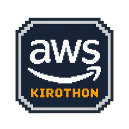 KIROTHON Store — AI project archive & team-matching platform · 🏆 Excellence Award 

`AWS KIROTHON Excellence Award (우수상) · Mar 2026 · two-person team` · `Role: AI agent & frontend`

> One place for students to archive projects, find competitions and match teammates, built by a two-person team in a one-day AWS hackathon with **[Kiro](https://kiro.dev)**.

-  &nbsp;**Spec-driven build in Kiro** — requirements → design → tasks: 8 user stories, a typed domain model and ~50 traced tasks, guided by steering docs and agent hooks
-  &nbsp;**AI concierge & frontend** — a Next.js 16 + React 19 prototype with a chat concierge and Vibe Coding guide, project archive, event board and team recruiting
-  &nbsp;**Planned AWS serverless backend** — CloudFront → Amplify → API Gateway → Lambda, with Bedrock for the concierge, DynamoDB for data, Cognito and S3

---

### 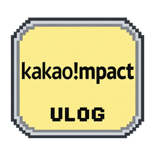 Ulog — Emotion-tracking KakaoTalk chatbot + PWA <picture><source media="(prefers-color-scheme: dark)" srcset="https://raw.githubusercontent.com/Happ11quokka/Happ11quokka/main/assets/kakaoimpact-white.svg"></picture>

`Backend & AI Engineer · 4-person team (I owned the backend)` · `Mentored by Kakao Impact Foundation · with Todaktodak Social Cooperative`

> A KakaoTalk chatbot that turns a feeling into an **Emotion Gem** and shows it back in a PWA. I owned the backend on a four-person team.

-  &nbsp;**Two-stage emotion classification** — a classifier LLM maps 25 expressions onto 10 emotion codes and a supervisor LLM corrects it: **41.7% → 97.3%**
-  &nbsp;**Async FastAPI backend** — answers within Kakao's 5-second webhook limit and sends the LLM result on the callback; PostgreSQL + async SQLAlchemy, per-user SSE gem updates
-  &nbsp;**Redis live analytics** — pipelined counters, HyperLogLog DAU / WAU / MAU, a 300 events/min rate limit and Pub/Sub fan-out to the dashboard's SSE

---

### 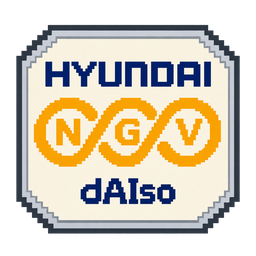 dAIso — Semiconductor Material Defect-Analysis AI Agent · 🏆 Grand Prize 

`Hanyang University × Hyundai NGV HYPER AI Competition · Jan 2026` · `Two-person team · AI agent design & development`

> An AI inspection agent that finds defects in semiconductor material images and analyzes each one with a multimodal LLM, built by a two-person team.

-  &nbsp;**Two-stage prompting** — YOLO detects defects, then GPT-4o analyzes each one
-  &nbsp;**Confidence-based recheck** — low-confidence calls rerun through one of four image-preprocessing tools
-  &nbsp;**Weighted voting** — results from each stage combine into the final defect verdict

---

### 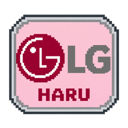 HARU — Home Adaptive Routine Understanding 

`Hanyang × LG Electronics IC-PBL · Sep – Dec 2025` · `4-person team · iOS app & UI/UX`

> An iPhone + Apple Watch smart-home app that adjusts appliances to the user's fatigue. I built the iOS / watchOS app and its UI/UX on a four-person team.

-  &nbsp;**SwiftUI + HealthKit** — background HealthKit queries for heart rate, steps and HRV; HRV goes to FastAPI every 30 min and comes back as a 1–4 fatigue level
-  &nbsp;**Apple Watch & location** — a workout session streams data to the phone over WatchConnectivity every 30 s, and a GPS timeline adds checkpoints on HRV jumps and stays
-  &nbsp;**AI control & demo** — GPT-4o appliance suggestions in a Sendbird chat, approved from a summary card; final demo to **LG Electronics**

<b>📦 More projects</b>

 

| Project | What it is | Stack | Link |
|:--------|:-----------|:------|:----:|
| **Mirae Asset AI Festival** | Disclosure Q&A agent over 4,204 DART filings from 70 companies: facts come from SQL tables, and RAG handles only the narrative questions |     | — |
| **ESG-report-KR** | Multimodal RAG over Korean ESG reports, with EXAONE answering from text and CLIP-embedded images |     |  |
| **LG Aimers 8th** | Compressed EXAONE-4.0-1.2B with GPTQ / AWQ quantization and served it on vLLM |    |  |
| **Motor Sticker Detection** | Vision QC agent that finds stickers on motor images and judges defects in a YOLO + VLM loop; presented to Korean government officials |     |  |
| **koplegame** | Real-time, hint-based matching game built as a PWA |    |  |

<!-- ══════════════════════════════════════════════════════ -->
<!-- RESEARCH                                                -->
<!-- ══════════════════════════════════════════════════════ -->

 

###  KDMS 2026 — Multimodal Context Mining for Semantic Labeling of Industrial Images <picture><source media="(prefers-color-scheme: dark)" srcset="https://raw.githubusercontent.com/Happ11quokka/Happ11quokka/main/assets/hccl-white.png"></picture>

`First author · Hanyang University HCC Lab` · *멀티모달 맥락 정보 기반 산업 이미지 의미 라벨링*

> OCR + MLLM turn panel text into meaning-based candidates that become **SAM 3** concept prompts, so labeling industrial control panels is confirm-only after the first image.

---

###  APAF 2025 — GPT-4.1 Nano Sentiment-Based Long-Short Strategy for Korean Equities <picture><source media="(prefers-color-scheme: dark)" srcset="https://raw.githubusercontent.com/Happ11quokka/Happ11quokka/main/assets/hanyang-business-white.png"></picture>

`Second author · Hanyang University Business School · Quantitative Analytics Lab`

> Scored **~500K Korean news articles** (2022.01–2025.03) with GPT-4.1 Nano, mapped each to its stock, joined FnGuide daily prices, and backtested a market-neutral long-short strategy by publication window (PRE / IN / AFTER / DAY-OFF).

**Cumulative return** `+11.91%` &nbsp;·&nbsp; **KOSPI, same window** `−14.43%` &nbsp;·&nbsp; **Sharpe** `0.38`

<!-- ══════════════════════════════════════════════════════ -->
<!-- AWARDS & ACTIVITIES                                     -->
<!-- ══════════════════════════════════════════════════════ -->

 

-  &nbsp;**Excellence Award** — [AWS KIROTHON Hackathon](https://n.news.naver.com/article/025/0003514864?sid=102) · `Mar 2026`
-  &nbsp;**Grand Prize** — [Hyundai NGV HYPER AI Hackathon](https://www.beyondpost.co.kr/view.php?ud=20260205175252753192e75d13a3_30) · `Jan 2026`
-  &nbsp;**1st Place** — [FORIF Programming Club Ideathon](https://forif.org/announcement/34) · `Dec 2025`
-  &nbsp;**3rd Place** — [HySpark Startup Club Demo Day](https://hyspark.career.greetinghr.com/ko/main) · `Jul 2025`
-  &nbsp;**Excellence Award** — [Hanyang University Startup Academy](https://startup.hanyang.ac.kr/) · `Dec 2024`
-  &nbsp;**2nd Place** — [HUCC Cryptography Competition](https://sites.google.com/view/hucc/%ED%95%9C%EC%96%91%EC%95%94%ED%98%B8%EA%B3%B5%EB%AA%A8%EC%A0%84) (Hanyang University Cryptography Club) · `Oct 2024`
-  &nbsp;**Gold Medal** — WorldQuant BRAIN Consultant

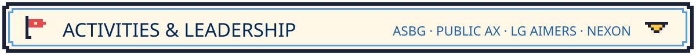

 

-  &nbsp;**Core Team** — [ASBG at HYU](https://asbg-hyu.vercel.app/#recruiting) (AWS Student Builders Group), founding cohort · `Aug 2026 – Present`
-  &nbsp;**Youth Public AX Supporter** — [Ministry of the Interior and Safety](https://www.mois.go.kr) × NIA, building *Youth Money Map (청년머니맵)* · `Sep 2026 – Jan 2027`
-  &nbsp;**Consultant** — WorldQuant BRAIN · IQC Stage 1 top 20%
-  &nbsp;**Participant** — [LG Aimers 8th cohort](https://www.lgaimers.ai/) · LG AI Research · `Jan – Feb 2026`
-  &nbsp;**Coding Mentor** — [Nexon Foundation HelloMate](https://kr-newsroom.nexon.com/press-center/3399289) · `Sep 2025 – Jan 2026`
-  &nbsp;**Member** — [HySpark Startup Club](https://hyspark.career.greetinghr.com/ko/main) (3rd cohort) · `2024 – 2025`
-  &nbsp;**Member** — [Hanyang Startup Academy](https://startup.hanyang.ac.kr/) (21st cohort) · `Sep – Dec 2024`
-  &nbsp;**Member** — [ICEWALL Security Club](https://github.com/hyu-icewall) · `Mar – Sep 2022`
-  &nbsp;**Activity Director** — [Habitat for Humanity](https://www.habitat.or.kr/business/education) · `Sep 2021 – Dec 2022`

<!-- ══════════════════════════════════════════════════════ -->
<!-- LATEST BLOG POSTS                                       -->
<!-- ══════════════════════════════════════════════════════ -->

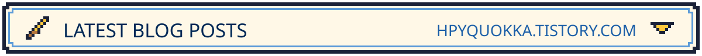

 

<!-- BLOG-POST-LIST:START -->
-  &nbsp;[**[청년 공공AX 서포터즈] 1차 활동 후기: OT부터 공공 GitLab**](https://hpyquokka.tistory.com/entry/%EC%B2%AD%EB%85%84-%EA%B3%B5%EA%B3%B5AX-%EC%84%9C%ED%8F%AC%ED%84%B0%EC%A6%88-1%EC%B0%A8-%ED%99%9C%EB%8F%99-%ED%9B%84%EA%B8%B0-OT%EB%B6%80%ED%84%B0-%EA%B3%B5%EA%B3%B5-GitLab) · `대외활동` · `Sep 2026`
-  &nbsp;[**Perch 4편. 운영·관측 — "장애가 나도 답변은 나가야 한다"**](https://hpyquokka.tistory.com/entry/Perch-4%ED%8E%B8-%EC%9A%B4%EC%98%81%C2%B7%EA%B4%80%EC%B8%A1-%E2%80%94-%EC%9E%A5%EC%95%A0%EA%B0%80-%EB%82%98%EB%8F%84-%EB%8B%B5%EB%B3%80%EC%9D%80-%EB%82%98%EA%B0%80%EC%95%BC-%ED%95%9C%EB%8B%A4) · `창업` · `May 2026`
-  &nbsp;[**Perch 3편. Vision 헬스체크 — "사진 한 장이 진단을 자처하지 않게 하는 법"**](https://hpyquokka.tistory.com/entry/Perch-3%ED%8E%B8-Vision-%ED%97%AC%EC%8A%A4%EC%B2%B4%ED%81%AC-%E2%80%94-%EC%82%AC%EC%A7%84-%ED%95%9C-%EC%9E%A5%EC%9D%B4-%EC%A7%84%EB%8B%A8%EC%9D%84-%EC%9E%90%EC%B2%98%ED%95%98%EC%A7%80-%EC%95%8A%EA%B2%8C-%ED%95%98%EB%8A%94-%EB%B2%95) · `창업` · `May 2026`
-  &nbsp;[**초거대 언어 모델(LLM) 압축 — Compressing Large Language Models**](https://hpyquokka.tistory.com/entry/CLLM) · `LG Aimers` · `Jan 2026`
<!-- BLOG-POST-LIST:END -->

<a href="https://hpyquokka.tistory.com/"> &nbsp;More on hpyquokka.tistory.com</a>

<!-- ══════════════════════════════════════════════════════ -->
<!-- CONTACT                                                 -->
<!-- ══════════════════════════════════════════════════════ -->

Always happy to chat about mobile apps, AI/ML research, agentic systems, or hackathons.

<!-- ══════════════════════════════════════════════════════ -->
<!-- FOOTER                                                  -->
<!-- ══════════════════════════════════════════════════════ -->

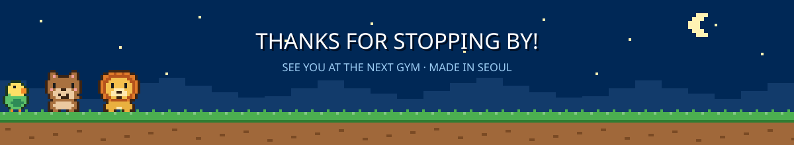
